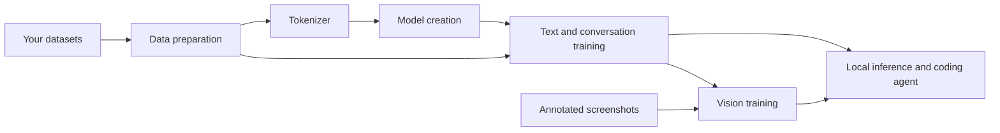

# champ-llm


**Choose its size. Train it from scratch. Teach it your domains.**

**champ-llm** is a framework for creating, training and running your own Llama-style language models. Configure a model size to suit your goals and hardware, build a tokenizer from your data, and train it in the languages and domains you choose.

The project brings together text and conversation training, resumable checkpoints, visual experiments and a coding agent that can inspect websites through a browser. It is experimental and ships as source code; you provide the data and train the model.

[Get started](GETTING_STARTED.md) · [Model configuration](docs/MODEL_SIZES.md) · [Data formats](DATASETS_AND_LANGUAGES.md) · [Browser & vision](VISION_AND_BROWSER.md) · [Contribute](CONTRIBUTING.md)

## What you can build

Your datasets define what your model learns. Possible directions include:

| Direction | Example training material |
| --- | --- |
| Multilingual assistants | French, English, Spanish and other languages; explanations and conversations |
| Domain specialists | Documentation, terminology and reviewed question-and-answer pairs in your field |
| Coding assistants | HTML, CSS, Sass/SCSS, JavaScript, TypeScript, JSON, PHP and other languages |
| Web application development | React, Node.js, SQL, APIs, SaaS features, tests and secure coding |
| Design and interfaces | Responsive layouts, GSAP animations, screenshots, critiques and verified corrections |

These are training directions. The resulting model's abilities depend on the quality of its data, training and evaluation.

## From data to a working model

- **Configure your model.** Use a size preset or define your own architecture dimensions.
- **Prepare your data.** Organize text, code and conversations, then build a tokenizer.
- **Train in stages.** Start with text and code, add conversation training, and resume from checkpoints.
- **Explore visual training.** Pair screenshots with descriptions, critiques and code.
- **Use your model.** Run local inference or connect it to the browser-assisted coding agent.



## Get started

Install Python 3.13, clone the repository and follow [Getting started](GETTING_STARTED.md) to set up your environment.

You can preview an architecture before preparing data:

```sh
python create_model.py --size 7b --plan
```

The plan reports parameter counts and memory estimates without creating model weights. Use a preset or a custom JSON configuration to choose the size that fits your project. See [model configuration and resource estimates](docs/MODEL_SIZES.md).

The training workflow is:

1. Add reviewed text, code and conversations to your corpus.
2. Prepare the data and finalize your tokenizer.
3. Create your model's initial weights.
4. Train, evaluate and save checkpoints.
5. Add further training stages as your dataset grows.

## Browser-assisted development

The coding agent can inspect a local website, propose edits, run your project tests and check the result in several browsers. It uses a trained local model or an Ollama backend. File changes require `--apply`.

Capture a site in several browsers:

```sh
python capture_website.py http://localhost:3000 --browser chrome --browser firefox --browser safari
```

Supported choices are Chromium, installed Google Chrome, Firefox and WebKit. The `safari` option selects Playwright's WebKit engine; it does not launch the Safari application. See [browser setup and visual training](VISION_AND_BROWSER.md).

## Status and requirements

Text training, checkpoints and local inference have integration tests using small models. Browser tests exercise real engines. Vision training and the coding agent remain experimental; model quality requires separate evaluation.

Training uses CUDA or small CPU experiments. Large-model GPU training and Unsloth integration still require validation. Check [model memory requirements](docs/MODEL_SIZES.md) and [GPU setup](TRAINING_ON_RUNPOD.md) before starting a substantial run. Test coverage and reference results are documented in [Validation](docs/VALIDATION.md).

The coding agent does not train itself during use. Reviewed corrections can become data for a later training run.

## Documentation

| Guide | What it covers |
| --- | --- |
| [Getting started](GETTING_STARTED.md) | Installation and your first training workflow |
| [Model configuration](docs/MODEL_SIZES.md) | Presets, custom dimensions and memory estimates |
| [Datasets and languages](DATASETS_AND_LANGUAGES.md) | Text, code, conversations and image annotations |
| [Conversations and checkpoints](CONVERSATIONS_CHECKPOINTS_AGENT.md) | Conversation training and resuming a run |
| [Vision and browser](VISION_AND_BROWSER.md) | Browser setup, screenshots and visual training |
| [Direct coding agent](DIRECT_AGENT.md) | Local inference and reviewing code changes |
| [GPU training](TRAINING_ON_RUNPOD.md) | GPU checks, training and checkpoint handling |
| [Validation](docs/VALIDATION.md) | Test coverage and reproduction commands |
| [Contributing](CONTRIBUTING.md) | Development setup and contribution guidelines |

## License

[MIT](LICENSE). Third-party dependencies, datasets and model artifacts retain their applicable licenses.
