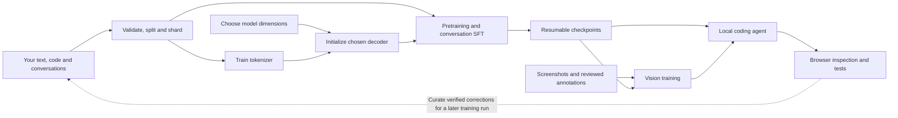

# champ-llm


**Choose its size. Train it from scratch. Teach it your domains.**

**champ-llm** is a framework for creating, training and running your own Llama-style language models from scratch. Choose a size preset or supply custom architecture dimensions before creating the weights. Its experimental Python codebase brings together dataset preparation, a custom tokenizer, randomly initialized model weights, text training, conversations, visual experiments and a browser-assisted coding loop.

The ambition: a multilingual collaborator that can discuss a brief, write web applications, inspect their interfaces and improve them. The repository provides the machinery to explore that ambition. Its capabilities still need to be learned and evaluated.

[Get started](GETTING_STARTED.md) · [Choose a model size](docs/MODEL_SIZES.md) · [Data formats](DATASETS_AND_LANGUAGES.md) · [Browser & vision](VISION_AND_BROWSER.md) · [Validation](docs/VALIDATION.md) · [Contribute](CONTRIBUTING.md)

## What makes this project interesting?

- **Choose the architecture first.** Preview the supplied size presets or plan a custom architecture in JSON, including sizes above 13B. Planning works before you have data or a tokenizer.
- **Start with your own foundations.** Train a byte-level BPE tokenizer and create a Llama-style decoder with random weights.
- **Keep the whole training path visible.** Prepare bounded shards, pretrain on text and code, then teach conversations with assistant-response masking.
- **Resume more than the weights.** Checkpoints preserve optimizer state, random-number state and the streaming data cursor.
- **Connect code to its appearance.** Capture responsive pages, bind annotations to screenshots by SHA-256, and experiment with a trainable vision encoder.
- **Close the development loop.** Inspect a local website, propose file edits, apply approved changes, then inspect and test again.

## Language, code and design

The codebase and documentation use English. The training data can use the languages you want to teach.

| Learning direction | Examples to curate |
| --- | --- |
| Human conversation | French, English, Spanish; explanations, requirements and multi-turn dialogue |
| Web foundations | HTML, CSS, Sass/SCSS, JavaScript, TypeScript, JSON and PHP |
| Applications | React, Node.js, SQL, API design, tests and SaaS features |
| Secure development | Secure coding, threat modeling, vulnerability remediation and regression tests |
| Motion and interfaces | GSAP examples, responsive layouts, screenshots, design critiques and verified corrections |

These are curriculum directions, **not skills already acquired by a shipped model**. No pretrained weights or training corpus are included. An advanced SaaS builder with strong visual judgment is a long-term target.

## How the pieces fit



The agent does not update model weights during use. Learning from a correction requires reviewing it, adding it to a dataset and running another training cycle.

## Try the browser loop first

You can exercise the browser integration without a trained model or GPU. Create and activate a Python 3.13 environment using the [setup guide](GETTING_STARTED.md), then run:

```sh
python -m pip install -r requirements-vision.txt
python -m playwright install chromium firefox webkit
python -m unittest discover -s tests -p test_real_browser_agent.py -v
```

The test opens a temporary local site in Chromium, Firefox and WebKit, exercises form interactions, detects horizontal overflow, applies a predefined correction and verifies mobile, tablet and desktop captures in each browser. Model responses are simulated; browser interaction is real. The temporary examples never enter your training corpus.

Playwright installs the engines for the current supported Windows, Linux or macOS system. Installed Google Chrome can also be selected. Some Linux installations also need system libraries; see [browser setup](VISION_AND_BROWSER.md#run-the-real-browser-test-on-windows-linux-or-macos).

Select one or several browsers when capturing a site or running the coding agent:

```sh
python capture_website.py http://localhost:3000 --browser chrome --browser firefox --browser safari
```

`chrome` uses installed Google Chrome; `firefox` uses Playwright's build; `safari`
is an explicit alias for WebKit, not the Safari application. Captures and reports
record the actual browser and version. The same repeated `--browser` option is
available in `coding_agent.py`. See [browser selection and tests](VISION_AND_BROWSER.md).

## Choose the size, then build a training run

Preview a size before preparing data or installing ML dependencies:

```sh
python create_model.py --size 7b --plan
```

Available presets: `20m`, `125m`, `350m`, `1b`, `3b`, `4b`, `7b`, `13b`.
Names are approximate; the plan reports the count for the selected vocabulary.
Custom architecture planning can exceed 13B through `--config`; 13B is only the
largest supplied preset. There is no implicit size.
See [model sizes and resource estimates](docs/MODEL_SIZES.md).

Once dependencies are installed and you have curated a representative corpus:

```sh
python prepare_data.py --max-mb 100 --chunk-chars 8192 --shard-mb 32
python prepare_tokenizer.py --vocab-size 32768
python create_model.py --size 7b --plan
```

The plan prints the proposed model size without allocating weights. Creating the model and starting training are separate, explicit steps described in [Getting started](GETTING_STARTED.md).

**Finalize your tokenizer before creating model weights.** Adding later datasets is supported; replacing token IDs after training starts is not a compatible update. Data preparation deliberately refuses an empty corpus.

## Current state

| Area | What exists today |
| --- | --- |
| Text and conversations | Streaming preparation, training, checkpoints and exact-resume tests on tiny Llama models |
| Direct inference | A local backend that loads compatible weights without requiring Ollama |
| Browser access | Chromium, Google Chrome, Firefox and WebKit selection; separate captures and diagnostics per browser |
| Vision | A randomly initialized image encoder and training pipeline; visual competence remains unvalidated |
| Model creation | Validated size presets and custom dimensions; explicit selection before weight creation |
| Large-model training | Training entry points implemented; full GPU runs at billion-parameter scale remain unvalidated |
| Data and weights | Intentionally absent from this source distribution |

**Latest recorded validation: 78 tests passed on Windows with Python 3.13.17, including real Chromium, Google Chrome, Firefox and WebKit browser loops.** These tests validate mechanics on small models, not the quality of a trained large model. See [the validation scope and reproduction commands](docs/VALIDATION.md).

The browser can use supported Windows, Linux and macOS installations. Training acceleration has separate requirements: the current training code targets CUDA or small CPU experiments; it does not implement Apple MPS training. Unsloth support for full training of the custom model remains experimental.

## Where the project goes next

- [ ] Curate multilingual and programming corpora with reserved evaluation sets.
- [ ] Measure learning on small models before a full GPU run at the chosen size.
- [ ] Build verified React, Node.js, JSON and SaaS task collections.
- [ ] Align screenshots, critiques and source code for visual training.
- [ ] Evaluate design quality, responsive behavior and animation workflows on unseen projects.

## Explore the repository

| Guide | What it covers |
| --- | --- |
| [Model sizes](docs/MODEL_SIZES.md) | Presets, custom architectures, parameter counts and resource estimates |
| [Getting started](GETTING_STARTED.md) | Environment setup, first checks and preparing your own data |
| [Datasets and languages](DATASETS_AND_LANGUAGES.md) | Text/code inputs, conversations and image annotations |
| [Conversations and checkpoints](CONVERSATIONS_CHECKPOINTS_AGENT.md) | SFT, resumption and development-loop feedback |
| [Vision and browser](VISION_AND_BROWSER.md) | Screenshots, annotations and visual experiments |
| [Direct coding agent](DIRECT_AGENT.md) | Local inference and controlled file edits |
| [GPU training](TRAINING_ON_RUNPOD.md) | Initial GPU checks and checkpoint handling |
| [Validation](docs/VALIDATION.md) | What has been tested and what remains unverified |
| [Contributing](CONTRIBUTING.md) | Useful contributions and how to verify them |

Local corpora, weights, checkpoints, environments and generated reports are excluded from Git. Empty dataset directories are created locally; they are not bundled example datasets.

## License

[MIT](LICENSE). Third-party dependencies retain their own licenses. Datasets and model artifacts you add require their own provenance and applicable permissions.
